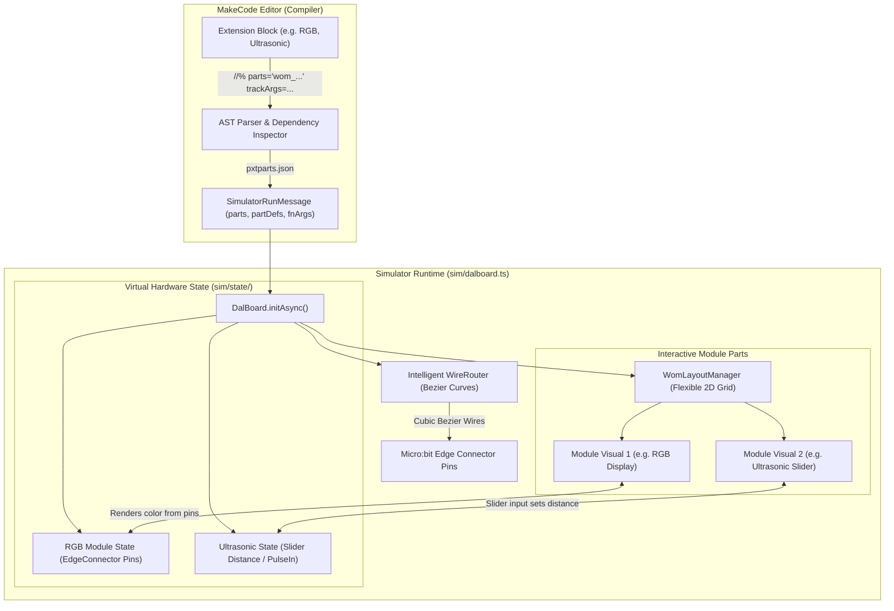

# Simulator Modular Architecture & Extension Guide

This document defines the architecture for implementing interactive hardware modules (sensors, actuators, displays) in the Microsoft MakeCode micro:bit simulator. It provides concrete instructions, design patterns, and standard templates so agents can add simulator support for extension blocks (such as `libs/Module-World`) **one by one**, ensuring they operate together seamlessly.

---

## 1. System Architecture Overview

When a user program runs in the MakeCode simulator, the runtime executes inside a sandboxed web-worker/iframe hosting `DalBoard`. The simulator pipeline operates as follows:



---

## 2. Core Subsystems

### 2.1 Flexible 2D Grid Layout Engine (`WomLayoutManager`)
Rather than constraining modules to a 1D breadboard row, modules are positioned in a dynamic **2D grid** below the micro:bit:
* **Coordinates**: The micro:bit occupies $(0, 0)$ to $(500, 400)$ with pins at $y \approx 396.7$. The module canvas starts at $y = 450$.
* **Grid Spec**: 
  * Columns: 2 or 3 (cell width $\approx 220\text{px}$, cell height $\approx 160\text{px}$, $X\text{-gap} = 30\text{px}$, $Y\text{-gap} = 30\text{px}$).
  * Module 0 $\rightarrow$ Row 0, Col 0 ($x=30, y=450$).
  * Module 1 $\rightarrow$ Row 0, Col 1 ($x=280, y=450$) (*placed to the side*).
  * Module 2 $\rightarrow$ Row 1, Col 0 ($x=30, y=640$) (*placed below*).
  * Module 3 $\rightarrow$ Row 1, Col 1 ($x=280, y=640$).
* **Dynamic ViewBox**: Automatically recalculates the host SVG `viewBox` height and width based on $(maxRow + 1)$ so no components or wires are cut off.

### 2.2 Intelligent Wire Routing (`WireRouter`)
Wires connect the micro:bit edge connector pins directly to the pin terminals on each module:
1. **Start Coordinate**: Obtained via `MicrobitBoardSvg.getCoord(pinName)` (e.g., `"P0"`, `"P1"`, `"P2"`, `"3V"`, `"GND"`).
2. **End Coordinate**: Computed as `(module.x + terminal.localX, module.y + terminal.localY)`.
3. **Curve Calculation**: Drawn using cubic Bezier SVG paths:
   $$\text{Path: } M(x_1, y_1) \quad C(x_1, y_1 + \text{droop}) \quad (x_2, y_2 - \text{droop}) \quad (x_2, y_2)$$
   where $\text{droop} = \min(90, \max(30, (y_2 - y_1) \times 0.45))$.
4. **Color Coding**:
   * `3V / VCC`: Red (`#e74c3c`)
   * `GND`: Dark Slate / Black (`#2c3e50`)
   * `Signal 1` (Trig, Analog, R): Orange (`#e67e22`) or Yellow (`#f1c40f`)
   * `Signal 2` (Echo, G, B): Green (`#2ecc71`) or Blue (`#3498db`)
5. **Styling**: Rendered with an outer shadow stroke (width 5, semi-transparent) and inner solid color stroke (width 3), plus crocodile or terminal clip caps.

### 2.3 Interactive SVG / HTML5 Controls (`<foreignObject>`)
To support interactive controls (such as distance sliders, obstacle toggles, rotary knobs) on top of module images:
* Use SVG `<foreignObject>` inside the module's SVG `<g>` element.
* Embed semantic HTML5 controls (`<input type="range">`, `<button>`, `<input type="checkbox">`).
* Example: An ultrasonic sensor renders its Yahboom PCB image, dual transducers, and an overlaid `<input type="range" min="2" max="400" value="50">` slider with live centimeter text readout.

---

## 3. Module Interface Contract

Every simulator module implements `visuals.IBoardPart<T>`:

```typescript
namespace pxsim.visuals {
    export interface IWomPinDef {
        pin: string;          // e.g. "P0", "P1", "3V", "GND"
        localX: number;       // Terminal X offset relative to module top-left
        localY: number;       // Terminal Y offset relative to module top-left
        color: string;        // Wire color hex
        label: string;        // "VCC", "GND", "Trig", "Echo", etc.
    }

    export interface IWomModuleVisual extends IBoardPart<any> {
        readonly moduleWidth: number;
        readonly moduleHeight: number;
        getPins(): IWomPinDef[];
        moveToCoord(xy: Coord): void;
        updateState(): void;
    }
}
```

---

## 4. Step-by-Step Recipe: Adding a New Module

To add simulator support for any command/block (one by one), follow these 5 steps:

### Step 1: Create Virtual State in `sim/state/<part>.ts`
Manage virtual sensor readings or actuator output and expose methods for the simulator.
```typescript
namespace pxsim {
    export class WomUltrasonicState {
        private distances: { [pinPair: string]: number } = {};

        public setDistance(pinKey: string, distCm: number) {
            this.distances[pinKey] = Math.max(0, Math.min(500, distCm));
            board().updateView();
        }

        public getDistance(pinKey: string): number {
            return this.distances[pinKey] !== undefined ? this.distances[pinKey] : 50;
        }
    }
}
```

### Step 2: Create Visual Component in `sim/visuals/<part>.ts`
Build the module SVG view with terminals, graphics, and interactive controls.
```typescript
namespace pxsim.visuals {
    export class WomUltrasonicView implements IWomModuleVisual {
        public style = "";
        public element: SVGElement;
        public defs: SVGElement[] = [];
        public readonly moduleWidth = 200;
        public readonly moduleHeight = 130;
        private state: WomUltrasonicState;
        private slider: HTMLInputElement;
        private label: SVGTextElement;
        private trigPin = "P2";
        private echoPin = "P3";

        public init(bus: EventBus, state: WomUltrasonicState, svgEl: SVGSVGElement, params: Map<string>) {
            this.state = state;
            if (params["trig"]) this.trigPin = params["trig"];
            if (params["echo"]) this.echoPin = params["echo"];
            this.buildDom();
            this.updateState();
        }

        private buildDom() {
            this.element = svg.elt("g", { class: "wom-module wom-ultrasonic" });
            
            // PCB Background
            const pcb = svg.elt("rect", { width: 200, height: 130, rx: 8, fill: "#1a252f", stroke: "#34495e", "stroke-width": 2 });
            this.element.appendChild(pcb);

            // Title
            const title = svg.child(this.element, "text", { x: 100, y: 22, "text-anchor": "middle", fill: "#ecf0f1", "font-size": "12px", "font-weight": "bold" });
            title.textContent = `Ultrasonic (${this.trigPin}/${this.echoPin})`;

            // Live Readout Label
            this.label = svg.child(this.element, "text", { x: 100, y: 55, "text-anchor": "middle", fill: "#f1c40f", "font-size": "18px", "font-weight": "bold" });

            // Interactive HTML5 Slider via foreignObject
            const fo = svg.child(this.element, "foreignObject", { x: 20, y: 70, width: 160, height: 40 });
            const input = document.createElement("input");
            input.type = "range";
            input.min = "2";
            input.max = "400";
            input.value = `${this.state.getDistance(this.echoPin)}`;
            input.style.width = "100%";
            input.style.cursor = "pointer";
            input.oninput = (e) => {
                const val = parseInt((e.target as HTMLInputElement).value);
                this.state.setDistance(this.echoPin, val);
            };
            fo.appendChild(input);
            this.slider = input;
        }

        public getPins(): IWomPinDef[] {
            return [
                { pin: this.trigPin, localX: 40, localY: 0, color: "#e67e22", label: "Trig" },
                { pin: this.echoPin, localX: 80, localY: 0, color: "#f1c40f", label: "Echo" },
                { pin: "3V", localX: 120, localY: 0, color: "#e74c3c", label: "VCC" },
                { pin: "GND", localX: 160, localY: 0, color: "#2c3e50", label: "GND" }
            ];
        }

        public moveToCoord(xy: Coord) {
            translateEl(this.element, xy);
        }

        public updateState() {
            const dist = this.state.getDistance(this.echoPin);
            this.label.textContent = `${dist} cm`;
            if (this.slider && document.activeElement !== this.slider) {
                this.slider.value = `${dist}`;
            }
        }

        public updateTheme() {}
    }
}
```

### Step 3: Register in `sim/dalboard.ts`
Link the state instance and visual factory to `DalBoard`.
```typescript
// In DalBoard constructor:
this.womUltrasonicState = new WomUltrasonicState();
this.builtinParts["wom_ultrasonic"] = this.womUltrasonicState;
this.builtinVisuals["wom_ultrasonic"] = () => new visuals.WomUltrasonicView();
```

### Step 4: Annotate Block in `libs/Module-World/Module-World.ts`
Attach the `parts` attribute and tracked pin parameters. For sensors with low-level microsecond loops (like Ultrasonic or DHT11), provide a simulator shim fallback:
```typescript
//% blockId=ModuleWorld_Digital_Ultrasonic block="Ultrasonic|pin %value_DNum"
//% weight=97
//% parts="wom_ultrasonic" trackArgs=0
//% shim=ModuleWorld_Digital::Ultrasonic
export function Ultrasonic(value_DNum: mwDigitalNum): number {
    // Hardware implementation runs on micro:bit; simulator executes the shim
    let Trig: DigitalPin, Echo: DigitalPin;
    // ... pin assignments ...
    const d = pins.pulseIn(Echo, PulseValue.High, 500 * 58);
    return Math.idiv(d, 58);
}
```
And in `sim/state/wom_shims.ts`, provide the shim:
```typescript
namespace pxsim.ModuleWorld_Digital {
    export function Ultrasonic(value_DNum: number): number {
        const pinMap: { [idx: number]: string } = { 1: "P1", 2: "P3", 3: "P4", 4: "P5", 5: "P7", 6: "P9", 7: "P11", 8: "P13", 9: "P15", 10: "P10" };
        const echoPin = pinMap[value_DNum] || "P1";
        return (board().builtinParts["wom_ultrasonic"] as WomUltrasonicState).getDistance(echoPin);
    }
}
```

### Step 5: Declare in `libs/Module-World/pxtparts.json`
Add the metadata mapping so MakeCode includes the visual in `msg.parts` and binds callsite pin arguments:
```json
{
  "wom_ultrasonic": {
    "simulationBehavior": "wom_ultrasonic",
    "visual": {
      "builtIn": "wom_ultrasonic",
      "width": 200,
      "height": 130,
      "pinDistance": 20,
      "pinLocations": [
        { "x": 40, "y": 0 },
        { "x": 80, "y": 0 },
        { "x": 120, "y": 0 },
        { "x": 160, "y": 0 }
      ]
    },
    "numberOfPins": 4,
    "pinDefinitions": [
      { "target": { "pinInstantiationIdx": 0 }, "style": "croc", "orientation": "+Z" },
      { "target": { "pinInstantiationIdx": 1 }, "style": "croc", "orientation": "+Z" },
      { "target": "threeVolt", "style": "croc", "orientation": "+Z" },
      { "target": "ground", "style": "croc", "orientation": "+Z" }
    ],
    "instantiations": [
      {
        "kind": "function",
        "fullyQualifiedName": "ModuleWorld_Digital.Ultrasonic",
        "argumentRoles": [
          { "pinInstantiationIdx": 0, "partParameter": "pinPair" }
        ]
      }
    ]
  }
}
```

---

## 5. Actuator Reference: RGB Diode (`wom_rgb`)

For actuators like RGB:
* **Visual**: Render an SVG module box with terminal pins at the top and a central `<rect id="rgb-swatch" width="60" height="60" rx="6" fill="#000"/>`.
* **State Interception**: Reads pin values written by `pins.analogWritePin(P13, r)`, `pins.analogWritePin(P14, g)`, `pins.analogWritePin(P12, b)` from `board().edgeConnectorState`.
* **Rendering**: In `updateState()`, fetch pin duty cycles, normalize to $0\text{--}255$:
  ```typescript
  const r = Math.round((board().edgeConnectorState.getPin(DAL.MICROBIT_ID_IO_P13).value / 1023) * 255);
  const g = Math.round((board().edgeConnectorState.getPin(DAL.MICROBIT_ID_IO_P14).value / 1023) * 255);
  const b = Math.round((board().edgeConnectorState.getPin(DAL.MICROBIT_ID_IO_P12).value / 1023) * 255);
  this.swatch.setAttribute("fill", `rgb(${r},${g},${b})`);
  ```
* **Wires**: 4 wires routed to `P13` (Red), `P14` (Green), `P12` (Blue), and `GND` (Black).

---

## 6. Yahboom Module-World Inventory & Port Mapping

### Port Mapping (`mwDigitalNum`)
| Enum ID | Name | Signal 1 (Trig / IN) | Signal 2 (Echo / OUT) | VCC / GND |
|---|---|---|---|---|
| 1 | `P0P1` | `P0` | `P1` | `3V / GND` |
| 2 | `P2P3` | `P2` | `P3` | `3V / GND` |
| 3 | `P3P4` | `P3` | `P4` | `3V / GND` |
| 4 | `P4P5` | `P4` | `P5` | `3V / GND` |
| 5 | `P6P7` | `P6` | `P7` | `3V / GND` |
| 6 | `P8P9` | `P8` | `P9` | `3V / GND` |
| 7 | `P10P11` | `P10` | `P11` | `3V / GND` |
| 8 | `P12P13` | `P12` | `P13` | `3V / GND` |
| 9 | `P14P15` | `P14` | `P15` | `3V / GND` |
| 10 | `P1P10` | `P1` | `P10` | `3V / GND` |

### Module Implementation Checklist
| Module | Type | Pins | Visual / Interactive Element |
|---|---|---|---|
| **RGB LED** | Actuator | P13, P14, P12, GND | Center square color swatch reflecting `rgb(r,g,b)` |
| **Ultrasonic** | Sensor | Trig, Echo, 3V, GND | Interactive distance slider ($2\text{--}400\text{ cm}$) |
| **DHT11** | Sensor | Signal, 3V, GND | Dual sliders: Temp ($-20\text{--}60^\circ\text{C}$), Humidity ($0\text{--}100\%$) |
| **IR Obstacle** | Sensor | Signal, 3V, GND | Obstacle / NoObstacle toggle button + LED indicator |
| **PIR Motion** | Sensor | Signal, 3V, GND | Motion trigger momentary / toggle button |
| **Collision Switch** | Sensor | Signal, 3V, GND | Press / Release interactive switch |
| **Button Module** | Sensor | Signal, 3V, GND | Clickable push button |
| **Light Sensor** | Sensor | Analog In, 3V, GND | Lux slider ($0\text{--}1023$) |
| **Sound Sensor** | Sensor | Analog In, 3V, GND | Decibel slider ($0\text{--}1023$) |
| **Potentiometer** | Sensor | Analog In, 3V, GND | Rotary knob / range slider ($0\text{--}1023$) |
| **Buzzer** | Actuator | Signal, GND | Animated sound wave pulse indicator |
| **Vibration Motor** | Actuator | Signal, GND | Animated shaking motor graphic |

---

## 7. Verification & Testing

After adding or modifying any module:
1. **Build target & packages**:
   ```bash
   pxt buildtarget
   ```
2. **Verify scoped extension build**:
   ```bash
   cd libs/Module-World && pxt build
   ```
3. **Run Dev Server with WebSocket token URL**:
   ```bash
   pxt serve --no-browser
   ```
   Open the browser using the complete token URL printed in the CLI output. Create a project combining two or more blocks (e.g. RGB + Ultrasonic) to verify side-by-side grid placement and wire routing.
